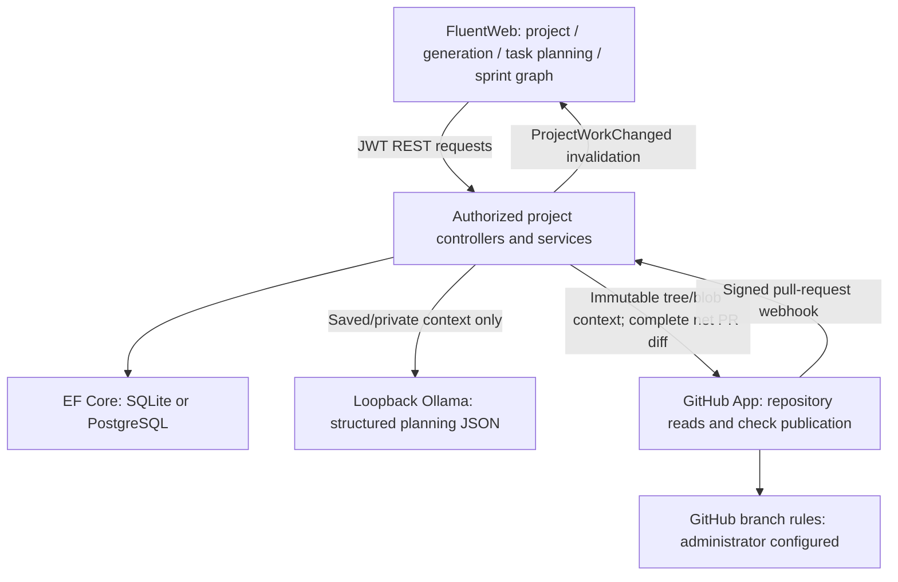

# Planning Architecture

ScrumPilot connects saved project context to reviewable work and bounded implementation scope without executing coding agents. This extends the existing .NET 10 API, EF Core persistence, shared contracts, Fluent UI Blazor client, and SignalR infrastructure.

## Component and Data Flow

`ScrumPilot.AppHost` launches both `web` and `fluentweb`. Only FluentWeb provides
the complete new planning workflows; original Web retains compatibility behavior.
The existing generic Groq/Ollama generation path is separate from project-aware
saved/private planning.

## Persisted Relationships and Provenance

The hierarchy is **Project → ProblemStatement → Story PBI → child Task PBI**.
One optional current-guideline pointer selects an immutable
`ProjectGuidelinesRevision`. A source problem may have many story generation
runs; generation does not invent a new problem identity.
Story/task previews retain source/run audit but create no draft/backlog PBIs.
Only acceptance creates work items; `AsDraft` controls accepted items' state.
Task-generation audit retains the exact request, instructions, and local context,
including failed-run inputs. Reusing an idempotency key with changed selected
stories, snapshot, or source paths conflicts rather than returning unrelated work.

| Data | Responsibility |
|---|---|
| `ProblemStatement` | Stable project-owned source, editable text/version, archive state |
| `GenerationRun` / `GenerationInput` | Execution state/idempotency and immutable exact input/hash, guidance/source/repository references |
| `ProductBacklogItem` | Existing Story/Bug/Task values plus parent/source/run/candidate IDs and version |
| `ProjectRepository` / `RepositorySnapshot` | Exclusive project/repository linkage; immutable branch, commit/tree SHA, verified paths |
| `TaskSpecificationRevision` / `TaskAllowedFile` | Immutable structured handoff, exact operations, approval actor/time/hash |
| `PbiDependency` | Normalized prerequisite edges, separate from parent containment |
| `ProjectGraphState` / `DependencyReview` | Graph revision and acceptance invalidation/review version |
| `TaskPullRequestBinding` / `PullRequestScopeCheck` | PR-to-task association and historical revision/head/base/merge-base results |
| `PullRequestScopeAttempt` | Durable repository/PR/head recovery journal committed before success publication |
| `NonTaskPullRequestException` / `GitHubWebhookDelivery` | Audited strict-policy exception and processed webhook delivery identity |

Append-only history and project-scoped foreign keys preserve provenance during
ordinary edits/deletions. Restoring guidance, amending scope, and approving a draft
append revisions rather than editing history. Authorized project deletion and
retention-controlled organization purge use an enclosing transaction with a
project-scoped `PlanningPurgeScopes` flag. Append-only DELETE triggers permit only
that scoped cleanup; ordinary history mutation/deletion stays rejected.
`AddPersistedPlanningFoundations` and `CompletePlanningScope` provide the additive
schema and guard changes. `AddPlanningArtifactApplicabilityReviews` adds
applicability-review history and append-only/purge triggers. These three migrations
passed actual PostgreSQL 17-alpine up/down/up and guard checks; SQLite up/down/up
and scoped purge also passed, and the EF model check was clean.
`JournalScopeValidationHeads` adds the recovery journal. Verify the complete
four-migration chain and current model using the
[rollout checks](../ScrumPilot.Data/README.md#rollout-precautions); earlier
three-migration results do not certify the journal migration.
See [data precautions](../ScrumPilot.Data/README.md#planning-schema-and-retention).

## Graph Authority and Readiness

`ProjectDependencyService` reads full project work, normalized/legacy edges,
pending reviews, and current specification metadata. The pure
`DependencyGraphEvaluator` then:

1. Builds direct prerequisite sets and inherits a parent story's prerequisites onto its tasks.
2. Adds committed-child completion requirements to stories (not a parent-before-child execution edge).
3. Detects effective cycles, including inherited requirements and child rollups.
4. Calculates completion satisfaction: committed Done work, satisfied prerequisites/children, valid parent, and no outstanding review.
5. Calculates dependency-ready: ToDo work with no blocker/review/draft/cycle reason.
6. Separates implementation eligibility: dependency-ready plus a current approved specification.

The API evaluates before selecting the sprint's nodes and transitive boundary
context. Missing references stay blockers. UI filters cannot alter readiness.
Children inherit sprint assignment; child points do not add to story-point totals.
Reopening prerequisites leaves downstream workflow statuses intact but invalidates
started/completed acceptance. Review cannot waive unresolved work.

Transactional graph mutations advance a revision; authorized SignalR invalidations
are sent after persistence. FluentWeb refetches on notification/window focus/reconnect and every
10 seconds, suppressing stale responses. Subscription tracking is in-process; this
is not a durable distributed event stream.

Owner source/content applicability reviews persist actor, time, reason, and an
exact content/source/guidance fingerprint. Matching reviews acknowledge retained
content without rewriting generation provenance or clearing dependency review.
Input changes invalidate the acknowledgement; this is separate from task-scope
approval and dependency acceptance.

## Privacy and Trust Boundaries

`LocalPlanningAi` accepts only an HTTP(S) loopback `OllamaBaseUrl` without URL
credentials and requires `OllamaModel`. Saved guidance, saved problems, and selected
private repository source never fall back to external AI. Context is untrusted
data, not authorization or executable repository instructions.

Guidelines and source blobs are limited to 128 KiB each; task context selects at
most 12 verified regular files. The assembled prompt limit is 192 KiB UTF-8.
Oversize/unverified context fails rather than silently dropping required input.
An Ollama endpoint's availability and local model operation still need deployment
verification.

The GitHub App holds secrets only on the API, reads repository content, and writes
Checks. Trusted scope lives in persisted Owner-approved revisions, not editable PR
text or manifests. Each GitHub repository is exclusively linked to one ScrumPilot
project so same-name checks cannot contradict one another. Validation checks exact
paths/operations, rename endpoints, complete net diff, approved snapshot merge-base,
and current specification inputs.
Approval additionally resolves the snapshot's recorded branch and rejects a moved
SHA until a fresh snapshot/new draft is reviewed and reapproved. This is not
continuous branch monitoring. Markdown exports include persisted/inherited
prerequisites; JSON manifests expose revision/hash/currentness, branch/SHA, and
exact file operations without becoming a new approval authority.

Scope validation and spec/guideline/problem/work-item input mutations acquire the
same database-backed project lock, serializing policy operations across API
instances sharing that database. PR binding commits before validation. Validation
then uses two separately locked transactions. Phase 1 invalidates all journaled
attempt and legacy-check heads, resolves the current head, publishes failure, and
commits that candidate to `PullRequestScopeAttempts` before any success. Phase 2
reacquires the lock, checks the same head and all current policy/full task-bound
diff, then publishes a result. Non-task exceptions use the same recovery protocol.

The committed journal survives cancellation/rollback of the final result save.
Subsequent retries/input mutations invalidate those heads even with a metadata
outage. Checks API unavailability is an integration failure that cannot
automatically retract a prior success. This is external-effect recovery, not
atomic GitHub merge isolation.

One linked repository has one global project-policy authority. Checks are
commit-scoped, so open PRs require distinct head SHAs; shared heads or incomplete/
changing open-PR enumeration block scope-check approval. Refresh/retry after
recovery. GitHub calls, database transactions, and merges are not one transaction:
asynchronous webhooks cannot provide instantaneous merge isolation.

`ScrumPilot / task-scope` becomes a merge gate only after a repository administrator
requires it and controls bypass/direct pushes. Configuration/check publication does
not verify branch protection. No prompt, allowlist, or check supplies a filesystem
sandbox, semantic review, or evidence that tests ran.

## Mermaid Versus Cytoscape

The API and FluentWeb share `DependencyGraphMermaid`, the authoritative serializer
for deterministic Mermaid snapshots of server-evaluated work.
Mermaid already integrates with the client and exports portable text/SVG. It is
not dependency storage, AI-authored scheduling authority, or an interactive graph
editing engine. State/search filters update the table and rerender the diagram,
retaining prerequisite context without recalculating readiness. Clicking a
diagram work-item node or activating it with Enter/Space opens details; the
accessible table remains an alternative for navigation and editing.

Cytoscape.js remains an alternative if measured browser behavior warrants a richer
incremental renderer; it is not installed as part of this feature. The pure
200-node/1,000-edge evaluator fixture passes. Separate renderer-only checks measured
a 1,617 ms initial render and 1,521 ms rerender for exactly 200 nodes/1,000 edges,
with zoom, keyboard activation, and targeted safety/race/fallback checks passing.
See the [measured environment and limitations](dependency-graphs.md#renderer-validation-and-performance).
Dense graphs still need filters/list navigation; this does not establish full
authenticated multi-client/Ollama/GitHub end-to-end behavior.

See [API contracts](api.md), [task handoffs](task-specifications.md),
[graph workflows](dependency-graphs.md), and [GitHub setup](github-task-scope-enforcement.md).