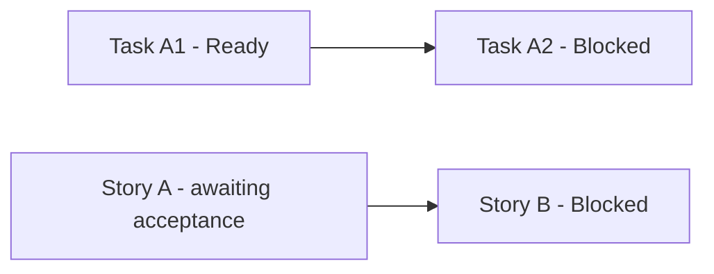

# Sprint Dependency Graphs

The database stores dependencies; the API calculates readiness; Mermaid renders
a snapshot. Mermaid text is not the scheduling authority and is not generated
directly by AI.

## Open a Sprint Graph

In FluentWeb, select a project, open `/scrum-board`, select a sprint, and follow its dependency-chart link. The route is `/dependency-chart?sprintId=<id>` with optional `projectId=<id>`. Opening it without a sprint asks you to choose one from the board; there is no graph-page sprint picker or all-sprints UI.

Members with project access can edit dependencies and review acceptance. External boundary work is read-only in this view. The original Web client remains compatibility-only.

The selected organization and project are part of the client work scope, not
inferred from the numeric sprint/project ID. Server graph routes are under
`/api/organizations/{organizationId}/projects/{projectId}`; the live connection
uses `/hubs/organizations/{organizationId}/project-work`. Equal local IDs in
different organization catalogs do not share subscriptions or notifications.

## Direction and Relationships

Arrows point from prerequisite to dependent:

A parent story groups tasks but is not a prerequisite requiring the parent to
close before its own children can start. Tasks inherit their story's
story-level prerequisites. Stories sharing a problem statement are related,
not automatically mutually dependent.

Multiple task prerequisites and cross-story task dependencies are supported
inside one project. Story dependencies connect stories. Self-dependencies,
duplicates, cross-project edges, and effective cycles are invalid. Effective
cycle checks include story completion rollups and inherited prerequisites.

## Status Legend

| State | Meaning |
|---|---|
| Ready | Committed ToDo work with all prerequisites satisfied and no dependency review outstanding |
| Blocked | One or more prerequisites/references prevent starting |
| Active | InProgress or InReview; not offered as ready-to-start work |
| Done | Workflow Done with valid completion |
| Needs review | A changed prerequisite or child invalidated an existing completion/active-work assumption |
| External | Outside the selected sprint; still relevant to dependency readiness |

State labels and the dependency list provide alternatives to color. Approved
task scope is separate from Ready. A Done story only satisfies dependents when
all committed children are complete and all required reviews are resolved.

## Closing and Reopening

1. A1 completes; A2 becomes Ready.
2. A2 completes. Story A still requires explicit acceptance/Done.
3. Story A closes; Story B's tasks can become Ready.
4. A1 reopens. Unstarted dependents block again. Active/Done dependents retain
   workflow status but require acceptance review; their invalidated completions
   no longer unblock downstream work.
5. Resolve upstream work and then review affected acceptance criteria. A prior
   review cannot acknowledge a new invalidation or waive an unresolved blocker.

The system does not automatically reopen every downstream task or automatically
close a story when its last child closes. Existing user flags remain independent.

## Sprint Boundaries

Select a sprint explicitly. Include disconnected items as well as connected
work. Prerequisites in another sprint/backlog appear as boundary work, not as
silently resolved. Their transitive dependencies still affect readiness.

Missing references block work. Deleting a referenced prerequisite requires
explicit dependency repair; deletion must not make dependents Ready.

Child tasks inherit story sprint assignment. Child task points do not add to
sprint commitment/completed point totals; standalone task accounting is unchanged.

## Display and Updates
Use **State filter** and **Story or problem ID / title** to filter the dependency
table and rerender the Mermaid diagram while retaining prerequisite context. Search matches IDs,
titles, parent story IDs, and problem IDs, not a separate problem-title lookup.
Readiness always comes from the full server evaluation, not the filtered subset.
The API and client share the authoritative `DependencyGraphMermaid` serializer.
The dependency table gives blocker reasons and work-detail buttons. Click a
diagram work-item node, or focus it and press **Enter** or **Space**, to open its
details. External boundary details remain read-only.
Keyboard-operable viewport controls provide zoom, pan, and reset. Mermaid and
SVG exports represent the displayed snapshot revision.

Use **Dependencies** to replace a row's prerequisites with comma-separated IDs;
empty input removes them. Saves carry the graph revision: on `409`, reload and
reconcile rather than overwrite newer changes. **Review acceptance** acknowledges
the current invalidation only after prerequisites/children are resolved.

Authorized `ProjectWorkChanged` notifications invalidate snapshots after committed
changes. The client refetches when the browser window regains focus,
resubscribes/refetches on reconnect, and refreshes every 10 seconds even while
connected; stale responses cannot replace a newer snapshot. Periodic
reconciliation remains available if focus observation is unavailable.
If rendering fails, use the accessible dependency list and retry. Access is
rechecked on subscriptions, notifications, and API reads; revoked access prevents
further authorized updates. Notifications are invalidations, not a durable event log.

## Why Mermaid

Mermaid already ships with ScrumPilot and supports portable Markdown/SVG output.
It is a good first choice for a read-oriented sprint graph. It does not provide
dependency storage, readiness computation, or live synchronization.

Cytoscape.js is an alternative if measured 200-node graph usability requires
incremental graph interaction. Changing the renderer must not change server
readiness rules. No custom graph editor or new framework is required initially.

### Renderer validation and performance

The pure evaluator's **200-node/1,000-edge fixture passes**. A separate synthetic
200-node/1,000-edge directed acyclic graph was measured after the SQL tenancy
port using the actual
FluentWeb `mermaid-helper.js` and existing Mermaid 10 CDN renderer:

| Environment / result | Observation |
|---|---|
| Browser / OS | VS Code integrated browser, Chrome 150 / Electron 43 on Windows |
| Browser-reported hardware | 16 logical processors; 32 GiB memory |
| Browser viewport / fixture | 341 × 573 / 1100 × 600 |
| Initial render / rerender | 1,210 ms / 1,155 ms |
| Rendered content | Exactly 200 nodes and 1,000 edges |
| Interaction / SVG checks | Zoom and keyboard node activation passed; no unsafe SVG elements found |

Separate browser checks passed for hostile labels, concurrent latest-render-wins,
and explicit accessible fallback when the renderer is missing. These are bounded
renderer-only observations, not a latency guarantee or full authenticated,
multi-client application/Ollama/GitHub end-to-end validation. Dense graphs still
need filters and the dependency list for practical navigation. The validation
server was stopped after these checks. This synthetic renderer measurement does
not establish whole-page mobile usability or authenticated application latency.

See [task scope versus readiness](task-specifications.md#readiness-is-not-scope-approval)
and [API graph contracts](api.md).
