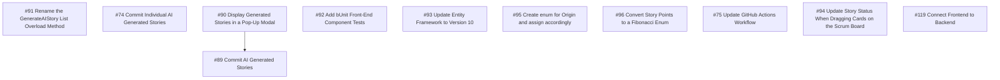

# Scrum Pilot Sprint 3 PBI Dependency Graph

Historical sprint record with retired integration work omitted. Current data
storage and deployment are described in [architecture](architecture.md) and
[operations](multi-tenancy-operations.md).

